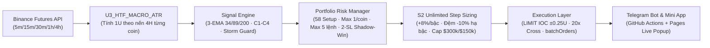

# CHICKTRADE v3.3 — HỒ SƠ AUDIT TOÀN BỘ HỆ THỐNG, CHECKLIST ĐIỂM NGỌT & TÀI LIỆU BÀN GIAO

> **Phiên bản chuẩn:** `v3.3-unlimited-s2` (`U3_HTF_MACRO_ATR` · 58 Setup Xuyên 3 Năm · `S2` Không Giới Hạn Bậc · Trần Thanh Khoản Thực Tế)  
> **Dữ liệu kiểm chứng:** 36 tháng liên tục Binance USD-M Futures (`01/11/2023 → 31/10/2026`, `315,648` nến `5m`/coin, 6 mã: `BTCUSDT`, `ETHUSDT`, `BNBUSDT`, `LINKUSDT`, `XRPUSDT`, `SOLUSDT`)  
> **Mục đích tài liệu:** Chuẩn hóa toàn bộ kiến trúc, công thức toán học, quy trình tìm điểm ngọt (SOP), kết quả kiểm chứng thực nghiệm và danh sách các điểm cần nâng cấp để bất kỳ kỹ sư/quant nào nhận bàn giao đều vận hành, tái lập và mở rộng được 100%.

---

## 1. TỔNG QUAN KIẾN TRÚC & BẢN ĐỒ HỆ THỐNG

### Cấu trúc thư mục chuẩn (`e:\CHICKTRADE\`)
| Thư mục / File | Vai trò | Trạng thái |
| :--- | :--- | :--- |
| `core/core_strategy_rules.json` | **Nguồn chân lý duy nhất (Single Source of Truth)** chứa 58 Setup `v3.3`, thông số `U3_HTF_MACRO_ATR`, `S2`, `Bao 400G / Auto-Turbo`, `PORTFOLIO 2-SL`. | ✅ Production v3.3 |
| `core/reports/chicktrade_6coin_master_report.html` | Báo cáo chi tiết 58 Setup (Light Mode + MMORPG Gold + Máy tính `0→200` bậc + Từ điển). | ✅ Đồng bộ `0` lệch |
| `core/reports/chicktrade_3year_showcase_report.html` | Báo cáo tổng quan 3 năm Hedge Fund Tear Sheet (`$10k → $1,048,302` Turbo / `$461,028` 400G). | ✅ Đồng bộ v3.3 |
| `core/onboard_coin.py` & `core/CHECKLIST_QUANT.md` | Bộ công cụ quét thêm coin mới & checklist định lượng 14 mục. | ✅ Sẵn sàng |
| `coins/<SYMBOL>/` | 6 thư mục cách ly (`audit_48.csv`, `rules.json`, `report.html`, `data/`), đồng bộ `MISMATCHES = 0`. | ✅ Đồng bộ v3.3 |
| `cloud_bot/` + `docs/` + `.github/workflows/` | Hệ thống **Paper-Test `$10,000` miễn phí 24/7** (GitHub Actions + GitHub Pages Telegram Mini App + Google Apps Script Webhook). | ✅ Đang chạy Live |
| `bot/` | Khung bot Live Binance Futures (`binance_broker.py`, `paper_broker.py`, `main_bot.py`, 18/18 unit test PASS). | ⏳ Chờ nối `v3.3` |
| `verified_tests/` | Toàn bộ script kiểm chứng & CSV chứng cứ (Walk-Forward, 2-SL, Session 24/7, `U3` Benchmark, `S2` 50+ bậc). | ✅ Đầy đủ chứng cứ |
| `graphify-out/` | Bản đồ tri thức mã nguồn (`508 nodes`, `1,580 edges`, `graph.html`, `GRAPH_REPORT.md`). | ✅ Đã tạo |
| `old/` | Lưu trữ script & output thử nghiệm cũ (đã loại khỏi `.graphifyignore`). | 🗄️ Archive |

---

## 2. TOÀN BỘ PHƯƠNG PHÁP TOÁN HỌC & QUY TẮC CỐT LÕI (`v3.3`)

### 2.1. Định chuẩn `1U` bất biến theo mọi vùng giá & mùa sóng (`U3_HTF_MACRO_ATR`)
- **Bài toán giải quyết:** `ATR(14)` ngắn hạn trên `15m` bị nhiễu giật cục (`3.5h`) làm gãy ngoài mẫu (`-11.7%` / `-16.6%`); còn `%` cố định bị lệch `25%–42%` khi mùa biến động đổi pha giữa các năm.
- **Công thức `v3.3` (100% Zero-Lookahead, tính riêng từng coin trên khung `4H` của chính coin đó):**
  $$\text{Macro}_{4H}(t) = \text{EMA}_{20}\left(\frac{0.5 \times \text{ATR}_{14,\,4H}(t)}{\text{Close}_{4H}(t)}\right)$$
  $$1U_{\%}(t) = \max\Big(0.0008,\; \text{Macro}_{4H}(t) \times \gamma_{tf}\Big), \quad \gamma_{tf} = \begin{cases} 0.29 & (15\text{m}) \\ 0.41 & (30\text{m}) \\ 0.59 & (1\text{h}) \end{cases}$$
  $$1U_{\text{giá}}(t) = \text{Close}(t) \times 1U_{\%}(t)$$
- **Nguyên tắc khóa rủi ro bất biến:** Khi thị trường bão (`1U_%` tăng `▲`), khoảng cách `SL/TP` giãn rộng để tránh quét râu oan, đồng thời khối lượng coin `Qty` tự động giảm tương ứng → **số tiền rủi ro USD của `1U` luôn khóa cứng theo Bậc vốn** (tại Mốc 0 `$10,000`, `Bao 400G`, `1.0×` → `1U = $25`, `SL 5U = -$125`).

### 2.2. Thước đo Winrate không bị bẫy bất đối xứng (`Profit-Weighted Winrate`)
- Vì `SL (5U–6U)` thường lớn hơn `TP1 (3.5U–4U)`, Winrate đếm số lệnh (`Trade WR`) có thể gây ảo giác. Hệ thống dùng **Winrate Lợi Nhuận**:
  $$\text{Thắng Tiền (\%)} = \frac{\text{Gross Profit}}{\text{Gross Profit} + \text{Gross Loss}} = \frac{\text{PF}}{\text{PF} + 1}$$
  - Mốc **`> 50%`** khẳng định **100% có lãi ròng** bất kể tỷ lệ `SL/TP`.
  - Hiển thị song song **4 nhánh kết quả**: `SL gốc` · `Dời/QuaySL` · `TP1` · `TP2`.

### 2.3. Quản trị vốn `S2 · Không Giới Hạn Bậc` & Bảo vệ danh mục
- **Lãi kép `S2_LOCKED_HYSTERESIS_10PCT` (`+8%/bậc`, không khóa trần số bậc):**
  - Tăng bậc ngay khi `Equity >= Initial × 1.08^(step + 1)`.
  - Giữ **cố định** `tier_capital = Initial × 1.08^step` khi thua nhẹ (giúp hồi phục Drawdown nhanh hơn `34.6 ngày` so với cách co theo Equity).
  - Chỉ hạ 1 bậc khi `Equity < tier_capital × 0.90` (đệm `-10%` chống bập bênh).
  - **Trần thanh khoản sổ lệnh thực tế (`Liquidity Cap`):** Tối đa `$300,000` Notional/lệnh cho `BTC/ETH` và `$150,000` cho Altcoin.
- **2 Chế độ Bao giá:**
  - **Bao `400 giá` (Chuẩn):** Max 5 lệnh đồng thời (`open_cap = 4.25`), max 1 lệnh/coin, rủi ro thực tế `0.69% – 1.28%` tài khoản/lệnh.
  - **Auto-Turbo (`400G → 250G`, công tắc ON/OFF):** Chỉ bật khi `Equity >= 1.25×` vốn gốc (`$12,500`), tắt khi `< 1.15×` (`$11,500`), **khóa sàn cứng `≥ 1.10×` (`$11,000`)** tính trên kịch bản xấu nhất toàn bộ lệnh đang mở cùng dính SL.
- **Phanh `PORTFOLIO 2-SL Core-Only → Shadow-Win`:**
  - Chỉ đếm **`SL_Full`** (thua thẳng từ đầu chưa qua `TP1`) của lệnh chính (`vol > 0.45×`). Lệnh đã ăn `TP1` rồi chân 2 quay đầu **không** kích hoạt phanh.
  - Đủ 2 lệnh `SL_Full` liên tiếp trên toàn danh mục → tạm dừng đánh tiền thật, chuyển sang **đánh nháp ngầm (`Shadow-Win`)** đến khi có **1 lệnh nháp thắng** (hoặc hết tối đa `72h`) mới đánh lại.
- **Chạy 24/7 không lọc phiên/cuối tuần:** Kiểm chứng thực nghiệm cho thấy cuối tuần (`WR 74.8%`, `PF 2.35`, đóng góp `45.8%` tổng lãi) và phiên Á (`00–07 UTC`) là khung giờ kiếm tiền mạnh nhất.

### 2.4. Bộ 4 Quy Tắc Khớp Lệnh Live Binance Futures
1. **Đóng nến xác nhận → bắn `LIMIT IOC ±0.25U`** (không đặt lệnh chờ đón trước tại EMA để tránh bẫy rơi dao; trượt quá `0.25U` sàn tự hủy, cấm đuổi giá `MARKET`).
2. **Mốc neo `SL/TP` vs `Dời SL`:** `SL gốc`, `TP1`, `TP2` neo cố định theo **giá tín hiệu gốc (`P_sig`)**; `Dời SL (0U / BE+Phí)` neo theo **giá khớp thực tế (`P_fill ± phí 2 chiều`)**; tính lại `Qty = Risk_$ / |P_limit - SL_gốc|` để khóa cứng rủi ro tiền thật.
3. **4 Trường hợp khẩn cấp sau `FILLED` (`batchOrders`):** (1) Bình thường → đặt gộp `SL + TP1 + TP2` (`reduceOnly=true`); (2) Xuyên `SL` / lỗi `-2021` → đóng `MARKET` ngay; (3) Vượt `TP1` → chốt `MARKET` 50%/100% ngay; (4) Timeout mạng 3 lần → `EMERGENCY_CLOSE` chống lệnh trần.
4. **Đòn bẩy & Min Volume:** Cài **`20× Cross Margin`** (tốn chỉ `35%` Equity cho 5 lệnh `400G`, `50%` cho `Turbo 250G`) + tự đọc `stepSize / minNotional / tickSize` từ `/fapi/v1/exchangeInfo`, luôn làm tròn xuống (`floor`).

---

## 3. CHECKLIST 10 BƯỚC TÌM ĐIỂM NGỌT & MỞ RỘNG COIN MỚI (SOP BÀN GIAO)

Khi muốn thêm 1 đồng coin mới (vd `AVAXUSDT`, `DOGEUSDT`, `SUIUSDT`) hoặc tái thẩm định định kỳ, người nhận bàn giao thực hiện đúng 10 bước sau:

1. **Tải tối thiểu 24–36 tháng nến `5m` Binance USD-M Futures** (không dùng dữ liệu `< 12 tháng` để tránh bẫy học vẹt 1 mùa).
2. **Loại bỏ khung `5m`** ngay từ đầu (71/72 tổ hợp `5m` bị phí sàn `0.02%/0.05%` + slippage bào mòn). Chỉ quét `15m`, `30m`, `1h`.
3. **Tính `1U` theo `U3_HTF_MACRO_ATR`** (trên khung `4H` của chính đồng coin đó, `EMA20`, sàn `0.08%`).
4. **Quét đủ 36 tổ hợp (`3 TF × 3 EMA [34/89/200] × 4 Chạm [C1–C4]`)** có bật `Storm Guard + Cooldown`.
5. **Tối ưu cá nhân hóa 7 kiến trúc Exit** cho từng setup (`ONLY_1R`, `ONLY_TP1`, `PARTIAL_NO_MOVE`, `PARTIAL_Entry-2U/-1U/0U`, `PARTIAL_BE+Phi`) với điều kiện bắt buộc `TP1_U > |Leg2_SL_U| + 0.6U` (chống bẫy rò phí).
6. **Bắt buộc kiểm chứng đa chu kỳ (Walk-Forward Split):**
   - Chia tập Train thành **2 năm độc lập** (`Năm 1` & `Năm 2`) và giữ riêng **Năm 3** làm tập Thi Mù (`Out-of-Sample`).
   - Setup đạt chuẩn **`CORE` (`0.85×`)**: `PF_Y1 ≥ 1.05`, `PF_Y2 ≥ 1.05`, `PF_2Y ≥ 1.50`, `N_2Y ≥ 10`.
   - Setup đạt chuẩn **`CORE_EXP` (`0.55×`)**: `PF_Y1 ≥ 1.05`, `PF_Y2 ≥ 1.05`, `1.20 ≤ PF_2Y < 1.50`, `N_2Y ≥ 10`.
   - **Loại bỏ tuyệt đối** mọi setup lỗ ở nửa gần nhất (`PF < 1.0`) hoặc lãi mỏng (`Thắng tiền < 55%`).
7. **Kiểm tra lệch chiều Long/Short (`Rule 1B`):** Chỉ khóa 1 chiều (`LONG_ONLY` / `SHORT_ONLY`) nếu chiều bị cắt **thua lỗ ở CẢ 2 năm** trong khi chiều giữ lại **thắng ở CẢ 2 năm**.
8. **Chạy mô phỏng gộp danh mục đầy đủ (`Bao 400G` + `Auto-Turbo 250G` + `2-SL Shadow-Win` + `S2 Unlimited`):** Đảm bảo thêm coin mới phải **tăng Calmar & không làm xấu MaxDD OOS**.
9. **Đồng bộ 1 nguồn chuẩn (`Single Source of Truth`):** Cập nhật `core/core_strategy_rules.json` và tái xuất `coins/<SYM>/audit_48.csv`, `rules.json`, assert `MISMATCHES == 0`.
10. **Cập nhật báo cáo HTML & tạo Git Tag mốc mới** (`git tag -f vX.Y-...`).

---

## 4. KẾT QUẢ KIỂM CHỨNG THỰC NGHIỆM (CHỨNG CỨ ĐÃ LƯU TRONG `verified_tests/results/`)

| Giai đoạn kiểm chứng (`v3.3 — 58 Setup`, Vốn `\$10,000`, 6 Coin đánh cùng lúc) | **Bao `400G` Chuẩn** | MaxDD `400G` | **Auto-Turbo `250G`** | MaxDD `Turbo` | File chứng cứ |
| :--- | :---: | :---: | :---: | :---: | :--- |
| **Full 36 Tháng (`11/2023 → 10/2026`, `S2 ∞ + Cap $300k/$150k`)** | **`+4,510.3%` (`$461,028`, Bậc 50)** | **`-10.05%`** | **`+10,383.0%` (`$1,048,302`, Bậc 60)** | **`-13.33%`** | `step50_s2_check.csv` |
| **Thi Mù 100% Năm 3 (`11/2025 → 10/2026`, Reset `$10k`, 0 nhìn trước)** | **`+28.57%` (`$12,857`)** | **`-11.00%`** | **`+37.13%` (`$13,713`, hồi `89d`)** | **`-14.00%`** | `step_sizing_ab_test.csv` |
| **Thi Mù Ngược 24 Tháng (`11/2023 → 10/2025`, Train Y3, 59 Setup)** | **`+44.19%` (`$14,419`)** | **`-14.53%`** | **`+45.02%` (`$14,502`)** | **`-16.61%`** | `step_sizing_ab_test.csv` |

---

## 5. AUDIT CÁC ĐIỂM CÒN THIẾU & LỘ TRÌNH NÂNG CẤP TIẾP THEO (GAP ANALYSIS)

Dưới đây là **6 hạng mục còn thiếu hoặc nên nâng cấp** trước khi vận hành vốn lớn ngoài đời thực, xếp theo thứ tự ưu tiên từ cao đến thấp:

| Ưu tiên | Hạng mục còn thiếu / Rủi ro hiện tại | Giải pháp nâng cấp đề xuất |
| :---: | :--- | :--- |
| **P0 (Bắt buộc trước Live)** | **`bot/` chưa nối bộ luật `v3.3`:** Thư mục `bot/` vẫn đang dùng `ATR(14)` cũ và chưa tích hợp `U3_HTF_MACRO_ATR`, `S2 Unlimited`, `PORTFOLIO 2-SL Core-Only → Shadow-Win`, `LIMIT IOC ±0.25U`, `batchOrders` & 4 case xử lý lỗi `-2021`. | Nâng cấp `bot/signal_engine.py`, `bot/execution/binance_broker.py`, `bot/state_store.py` khớp 100% `v3.3`, sau đó chạy full test trên **Binance Futures Testnet** trước khi nạp tiền thật. |
| **P1 (Bảo mật IP)** | **Repo `giltpinktee/chicktrade-live` đang là `Public`:** Người biết link có thể xem `core_strategy_rules.json` và `paper_engine_v3.py` *(Token Telegram vẫn an toàn 100% trong Secrets)*. | Chuyển `chicktrade-live` sang **`Private`**, tách 1 repo Public siêu nhẹ chỉ chứa đúng `docs/index.html` + `docs/data/live_dashboard.json` phục vụ Popup Telegram. |
| **P1 (UX Telegram)** | **Chưa bật Google Apps Script Webhook:** Hiện bạn bè đã bấm nút **`Bảng Lệnh Live`** mở Popup ngon lành, nhưng gõ lệnh text `/status`, `/orders`, `/1u` trong chat chưa có server trả lời tức thì. | Dán file `cloud_bot/telegram_gas_webhook.gs` vào Google Apps Script (`$0` miễn phí) và chạy hàm `setWebhook()` 1 lần duy nhất (mất 2 phút theo `SETUP_FREE_GUIDE.md`). |
| **P2 (Tăng Alpha thật OOS)** | **Bộ 58 Setup đang khóa cố định suốt 12 tháng:** Thị trường crypto đổi pha mỗi 3–6 tháng nên lãi Thi Mù dừng ở `+29% – +40%/năm`. | Nghiên cứu & chạy thử **Rolling Walk-Forward 3–6 Tháng** (tự động re-scan định kỳ để bật setup hợp pha mới & tạm tắt setup gãy pha). |
| **P2 (Độ chính xác Backtest)** | **Chưa mô phỏng Funding Rate 8h lịch sử & Stress-test Slippage cao:** Backtest hiện trừ phí `0.02%/0.05%` + trượt giá `0.01%`, chưa trừ Funding Rate lịch sử (ước tính ảnh hưởng `~3%–5%/năm` với lệnh `1h`). | Bổ sung bộ tải `fundingRate` lịch sử Binance Data Vision vào engine backtest để có báo cáo PnL ròng sau Funding 100%. |
| **P3 (Hạ tầng Live 24/7)** | **GitHub Actions Cron có thể trễ `2–5 phút`:** Đủ tốt cho Paper-Test miễn phí, nhưng chưa đủ chuẩn từng giây cho tiền thật. | Khi đánh tiền thật, chuyển `bot/` lên **VPS Tokyo/Singapore** (`~$5/tháng`, ping `< 30ms` tới Binance), bật systemd auto-restart + Watchdog kiểm tra SL mỗi 15s + cảnh báo Telegram khi mất kết nối. |
